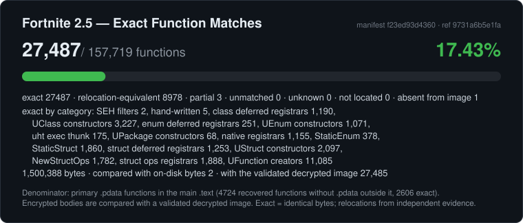

# Fortnite 2.5 reconstruction

Stage 1 builds and tests the tools for reconstructing the Win64 client and comparing compiled functions with the original executable. The repository excludes the original game files.

The graphic counts raw-byte matches among identified eligible functions. The initial baseline has zero verified matches and no confirmed eligible ranges.

[Build and reproduce](docs/BUILDING.md) · [Current status](docs/STATUS.md) · [Reverse-engineering notes](docs/REVERSE_ENGINEERING.md)
